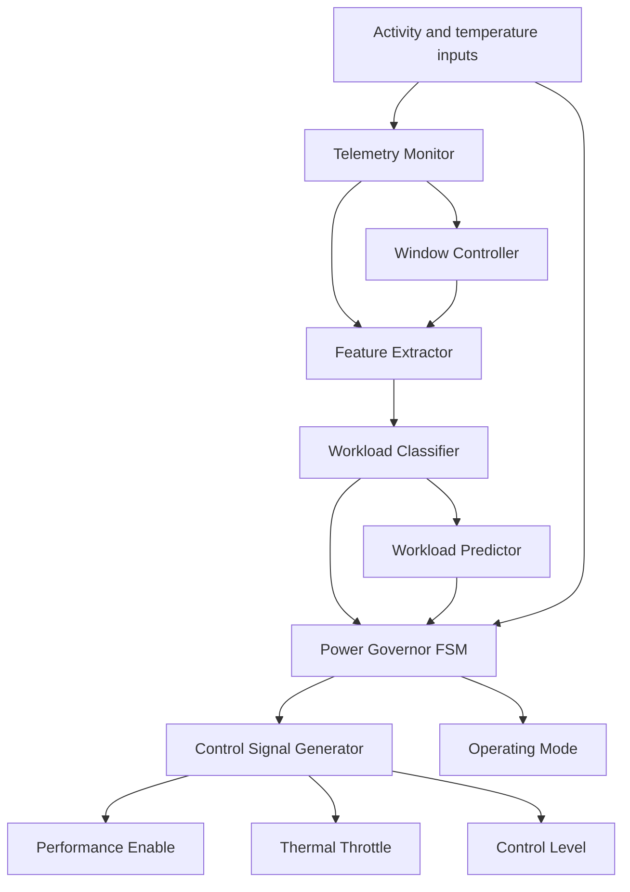

# PwrGov-X: Telemetry-Driven Power Governor IP

PwrGov-X is an educational digital power-management controller implemented in Verilog-2001 for the Tiny Tapeout platform using the SkyWater SKY130 ASIC design flow.

The design monitors activity and temperature inputs, classifies workload intensity, tracks workload trends, and generates operating-mode and thermal-throttling control signals. It demonstrates how lightweight RTL logic can support workload-aware power-management decisions.

**Project status:** The documented automated flow reports successful GDS generation and associated checks. Shuttle acceptance and fabrication are not confirmed.

## Project Links

- **RTL implementation:** [src/project.v](src/project.v)
- **Cocotb integration tests:** [test/test.py](test/test.py)
- **Test harness:** [test/tb.v](test/tb.v)
- **Tiny Tapeout configuration:** [info.yaml](info.yaml)
- **Project documentation:** [docs/info.md](docs/info.md)
- **Automated workflows:** [.github/workflows](.github/workflows)

## Highlights

- Verilog-2001 RTL design organized into eight modules
- Tiny Tapeout standard interface
- Activity monitoring over a fixed 16-cycle window
- Workload classification into low, medium, and high categories
- Lightweight workload-trend prediction
- FSM-based power-mode selection
- Thermal throttling with hysteresis
- Cocotb integration testing and gate-level verification
- Automated SKY130 implementation flow through GitHub Actions

## Motivation

Digital systems such as CPUs, system-on-chips, embedded processors, and AI accelerators must balance performance, power consumption, and temperature.

Operating continuously at maximum performance can waste energy under light workloads, while elevated temperatures may require performance throttling.

PwrGov-X explores a lightweight hardware approach using activity and temperature telemetry to select an appropriate operating mode.

This is an educational RTL and ASIC implementation project. It is not a replacement for a production power-management unit or a complete commercial dynamic-voltage-and-frequency-scaling (DVFS) controller.

## Architecture

The design is organized into eight RTL modules.

| Module | Responsibility |
|---|---|
| `tt_um_pwrgovx` | Top-level Tiny Tapeout wrapper and signal mapping |
| `telemetry_monitor` | Tracks active, idle, and total cycle counts |
| `window_controller` | Controls the telemetry measurement window |
| `feature_extractor` | Produces an activity metric from telemetry counters |
| `workload_classifier` | Classifies workload using the extracted activity metric |
| `workload_predictor` | Tracks workload trends |
| `pwrgov_fsm` | Selects the operating mode and manages thermal hysteresis |
| `control_signal_generator` | Generates performance, throttle, and control-level outputs |

### Functional Flow



*The diagram summarizes the intended functional relationships. Consult the RTL for the exact implemented signal connections and timing.*

### Operating Modes

| Mode | Encoding | Description |
|---|---|---|
| Low power | `2'b00` | Reduced-activity operating mode |
| Normal | `2'b01` | Normal operating mode |
| Throttled | `2'b10` | Thermal-protection mode |

The FSM requests thermal throttling when the temperature code reaches 6 or higher. Once throttling is active, it remains active at temperature code 5 and releases at code 4 or lower.

This hysteresis helps prevent rapid switching around the thermal threshold.

When the enable request is inactive, the design returns to its low-power mode.

## Tiny Tapeout Interface

The top-level module is `tt_um_pwrgovx`.

### Inputs

| Signal | Description |
|---|---|
| `clk` | Clock input |
| `rst_n` | Active-low reset |
| `ena` | Tiny Tapeout design enable |
| `ui_in[0]` | Enable request |
| `ui_in[1]` | Activity input |
| `ui_in[4:2]` | Three-bit temperature code |
| `ui_in[7:5]` | Reserved inputs |
| `uio_in[7:0]` | Bidirectional input bus, unused by the design |

The internal enable request is formed from `ena` and `ui_in[0]`.

### Outputs

| Signal | Description |
|---|---|
| `uo_out[0]` | Performance enable |
| `uo_out[1]` | Throttle active |
| `uo_out[3:2]` | Control level |
| `uo_out[5:4]` | Workload class |
| `uo_out[7:6]` | Operating mode |
| `uio_out[7:0]` | Held at zero |
| `uio_oe[7:0]` | Held at zero; bidirectional pins disabled |

### Workload Classification

The implementation uses the active-cycle count within its measurement window to distinguish workload levels.

| Active samples | Class encoding | Classification |
|---|---|---|
| 0–3 | `2'b00` | Low |
| 4–9 | `2'b01` | Medium |
| 10–16 | `2'b10` | High |

The workload trend is represented internally as:

- `2'b00` — Stable
- `2'b01` — Rising
- `2'b10` — Falling

## Verification

The repository includes a Cocotb integration test in [`test/test.py`](test/test.py) and a Tiny Tapeout test harness in [`test/tb.v`](test/tb.v).

The documented integration tests cover:

- Reset behavior and low-power mode
- Thermal-throttle entry at temperature code 6
- Thermal hysteresis at temperature code 5
- Throttle release at temperature code 4
- Safe outputs when the enable request is disabled
- Unused bidirectional outputs and output enables remaining low

### Verification Summary

The project's documented GitHub Actions results report the following checks as passed.

| Check | Reported result |
|---|---|
| GDS generation | Passed |
| Tiny Tapeout precheck | Passed |
| Gate-level test (`gl_test`) | Passed |
| Viewer deployment | Passed |

These are reported workflow results, not a claim that every possible input sequence has been exhaustively verified.

For reproducibility, link the exact successful workflow run and corresponding commit here once confirmed:

- **Successful workflow run:** Add the verified GitHub Actions run URL.
- **Commit identifier:** Add the commit SHA associated with that run.

## Physical Design Results

The documented GDS workflow reported the following routing statistics.

| Metric | Recorded result |
|---|---:|
| Routing utilization | 8.374% |
| Reported wire length | 2,569 µm |
| GDS generation | Successful |
| Reported linter warnings | 449 |

These values are reported EDA-flow results, not measurements from fabricated silicon.

The 449 reported linter warnings should be reviewed and understood before any fabrication submission. Successful flow completion does not establish that every warning is harmless or that the design meets all fabrication requirements.

For reproducibility, retain the successful workflow URL, commit identifier, GDS artifacts, and accompanying reports.

## Repository Structure

```text
power_governer_tiny_tapeout/
├── .github/
│   └── workflows/       # Automated test and GDS workflows
├── docs/
│   └── info.md          # Tiny Tapeout project documentation
├── src/
│   └── project.v        # Top wrapper and PwrGov-X RTL modules
├── test/
│   ├── Makefile         # Cocotb simulation configuration
│   ├── tb.v             # Tiny Tapeout test harness
│   └── test.py          # Cocotb integration tests
├── info.yaml            # Project metadata and pin descriptions
└── README.md             # Project overview and documentation
```

## Limitations and Future Work

- Activity and temperature signals are simplified telemetry inputs.
- Workload classification and trend prediction use lightweight digital logic.
- The design does not implement actual voltage scaling, clock-frequency scaling, or a physical power-delivery controller.
- The reported physical-design warnings require review before fabrication submission.
- Further work could include more extensive workload verification, additional activity and temperature scenarios, power estimation, and hardware-level validation.

## Team Members

PwrGov-X was developed collaboratively by a four-member team. The project combines digital architecture, RTL control logic, integration, verification, and exploration of the Tiny Tapeout ASIC implementation flow.

- **Shreyas C N** — [GitHub](https://github.com/ShreyasCN-19)
- **Thejas Gowda KR** — [GitHub](https://github.com/thejasgowda-05)
- **Varun K B** — [GitHub](https://github.com/VarunKB06)
- **Rahul A R** — [GitHub](https://github.com/rahular2005)

The listed team members contributed to the collaborative project. Individual responsibilities should be documented separately only where they have been confirmed.

## Acknowledgements

This project builds on the Tiny Tapeout Verilog project template, the SKY130 process design kit, Cocotb, and the automated Tiny Tapeout physical-design workflow.

- [Tiny Tapeout](https://tinytapeout.com/)
- [Original project repository](https://github.com/ShreyasCN-19/power_governer_tiny_tapeout)
